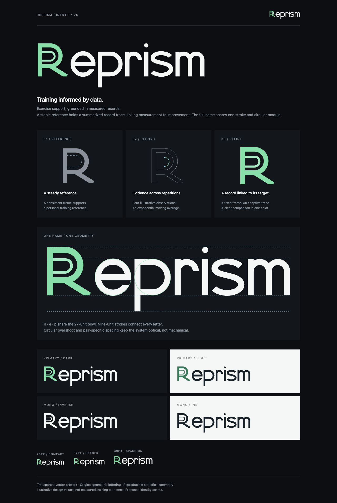

# Brand Design Skill

A Codex skill for developing vector logos from brand philosophy, geometric constraints, and practical usage requirements.

The workflow connects **intent → geometric operation → parameters → visual result → verification**. It helps keep construction logic reproducible while leaving room for optical judgment. No brand name, letter, palette, typeface, or proportion is built into the general workflow.

## What is included

- **[Design skill](brand-design/SKILL.md):** guidance for turning a brief into a shape grammar, exploring variations, and reviewing the result.
- **[Brief format](brand-design/references/brief-contract.md):** how to separate philosophies, hard constraints, exploratory rules, and assumptions.
- **[Geometry renderer](brand-design/scripts/render_geometry.py):** a dependency-free Python tool for parameterized SVG primitives, compound paths, affine transformations, and construction guides.
- **[Recipe format](brand-design/references/recipe-contract.md):** supported expressions, shapes, palettes, and recorded rationale.
- **[Reprism example](examples/reprism/case-study.md):** a complete worked design study with source parameters, a Boolean geometry extension, original geometric lettering, and generated assets.

## Install in Codex

Clone this repository and copy the `brand-design` directory into your user skills directory: `$CODEX_HOME/skills` if configured, otherwise `~/.codex/skills`.

```sh
git clone https://github.com/longdoheun/brand-design-skill.git
mkdir -p "${CODEX_HOME:-$HOME/.codex}/skills"
cp -R brand-design-skill/brand-design "${CODEX_HOME:-$HOME/.codex}/skills/"
```

Invoke it as `$brand-design`. The installed skill does not depend on the example directory. When updating an existing installation, replace the installed skill with the latest version rather than mixing files from different versions.

## Start a design

Provide a short brief in ordinary language; structured JSON is optional. Include the brand name, a few design philosophies, geometric rules, and intended applications. Existing assets and things to preserve or avoid are useful when revising a brand.

```text
$brand-design
Brand: A new learning platform
Philosophies: Curiosity, gradual discovery, calm confidence
Rules: Use a shared grid and meaningful negative space
Application: A 32px web header, on light and dark surfaces
Avoid: Book and lightbulb pictograms
Explore: An open form and a more compact form, with an outlined wordmark
```

The skill guides the design reasoning. The renderer executes an explicit geometry recipe; it does not infer symbolism or judge aesthetic quality automatically.

## Generate and vary geometry

The general renderer requires **Python 3.10+**, with no additional packages or network access. Supply your own brief and recipe:

```sh
python brand-design/scripts/render_geometry.py \
  --brief path/to/brief.json \
  --recipe path/to/recipe.json \
  --output output/base
```

Use repeatable `--set NAME=EXPRESSION` arguments to vary existing adjustable parameters. For example, a recipe with an `angle` parameter can be explored with `--set angle=15 --output output/view-15`. Check the brief's hard constraints before changing a parameter.

Outputs include palette variants, a separate construction SVG, and a JSON manifest of resolved parameters and philosophy mappings. Mappings that are missing or pending remain explicitly unresolved. Rendered inspection is still necessary to assess counters, clipping, optical weight, and small-size legibility.

## Reprism: data-guided training support

Reprism is a worked example of an exercise assistant built around measured movement, accumulated records, and statistical feedback. A fixed outer R provides the reference frame. Its inner trace is constructed from an exponential moving average of illustrative observations and positioned relative to a target curve. The complete name shares a geometric grammar: R/e/p bowls, a common construction stroke, linked lowercase proportions, and related r/m arches. Pair-specific spacing and disclosed optical corrections refine the result. The relationship remains visible in monochrome; construction guides stay out of the finished artwork.



See the [case study](examples/reprism/case-study.md), [design parameters](examples/reprism/design.json), and [generated SVGs](examples/reprism/generated/). Earlier studies are preserved under `examples/reprism/archive/`.

This example uses Boolean geometry and original lettering beyond the general renderer. To reproduce it, install its build-time requirements in a virtual environment:

```sh
python -m venv .venv
.venv/bin/python -m pip install -r examples/reprism/requirements.txt
.venv/bin/python examples/reprism/scripts/generate_calibration.py \
  --output output/reprism
```

`--alpha 0.25` or `--alpha 0.75` explores another statistical smoothing gain. The reference frame stays fixed while the inner trace changes. Use this example generator for structural changes: its exported `render-recipe.json` contains flattened geometry, not the authoritative statistical source. The example's lettering, colors, proportions, and construction are project-specific choices.

## Verify

Run the general renderer's tests with:

```sh
python -m unittest discover -s brand-design/scripts -p 'test_*.py'
```

The Reprism example also includes geometry checks for its reference stability, statistical summaries, target-relative coordinates, topology, clearance, full-wordmark spacing, letterform scaling, and reproducibility. With its build-time requirements installed, run:

```sh
.venv/bin/python -m unittest discover -s examples/reprism/scripts -p 'test_*.py'
```

These checks verify construction properties; they do not establish how an audience interprets the logo. The example is a proposed identity asset, not an application deployment.

## References and archived font attribution

The skill's [construction reference](brand-design/references/geometric-construction.md) links to primary design cases from Google, Pentagram, and IBM. They are references, not affiliated brands or reusable proprietary artwork.

Archived Reprism studies use Manrope, distributed under the [SIL Open Font License](examples/reprism/assets/fonts/OFL.txt). Its font source, FONTLOG, and SHA-256 provenance are included with the example. The current signature uses original geometric lettering. Runtime SVG usage requires no font installation.
