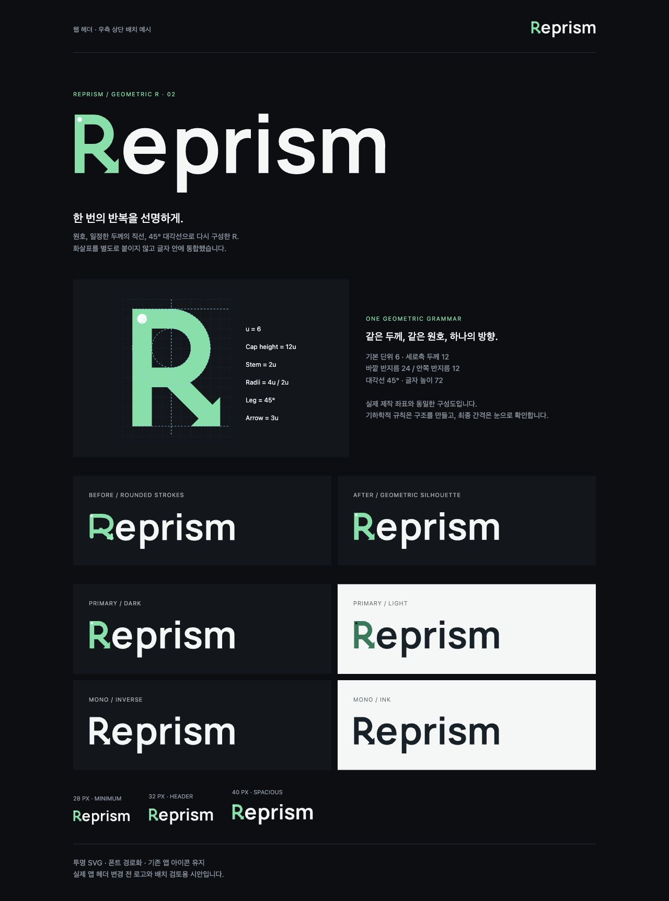

# Brand Design Skill

Reprism 로고 설계 과정에서 만든 독립형 Codex 스킬입니다. 현재 브랜드 프로필은 **`reprism-brand`**이며, 공통 기하학 설계 원칙과 브랜드별 수치를 분리했습니다.

- [스킬](reprism-brand/SKILL.md): 사용 조건, 제작·검증 흐름
- [기하학 설계 원칙](reprism-brand/references/geometric-construction.md): Google·Pentagram·IBM의 원문 사례와 적용 기준
- [Reprism 브랜드 규칙](reprism-brand/references/identity.md): 색상, 실제 구성 좌표, 타이포그래피, 여백
- [제작 도구](reprism-brand/scripts/generate_wordmark.py): 동일한 좌표로 SVG 로고와 구성도 재생성
- [SVG 자산](reprism-brand/assets/logos/): 심볼·워드마크 각각 4종과 구성도

## 사용

`reprism-brand` 폴더 전체를 Codex의 사용자 스킬 디렉터리에 설치한 후 `$reprism-brand`로 사용할 수 있습니다. 별도 Reprism 저장소나 작성자의 로컬 경로에 의존하지 않습니다. 일반적인 기하학 원칙은 다른 브랜드에도 참고할 수 있지만, Reprism의 색상·수치를 다른 브랜드에 강제하지 않습니다.

SVG 파일 사용에는 Python이나 폰트 설치가 필요 없습니다. 자산을 다시 생성할 때만 Python 3.10+의 격리 환경에 `fonttools==4.65.0`을 설치하고 실행합니다.

```sh
python reprism-brand/scripts/generate_wordmark.py --output /your/output/directory
```

폰트는 공식 Google Fonts의 Manrope를 포함했으며, 원본 SHA-256을 검사합니다. [폰트 라이선스](reprism-brand/assets/fonts/OFL.txt)와 FONTLOG를 함께 보존합니다. 다운로드나 글꼴 설치 없이 다른 작업 디렉터리에서도 동일하게 재생성됩니다.

## 현재 시안

R은 6단위 그리드, 12단위 일정 두께, 24/12 반지름, 45° 대각선과 일체형 화살표로 구성했습니다. 실제 앱 아이콘과 웹사이트 헤더 배치 변경은 별도 작업입니다.


